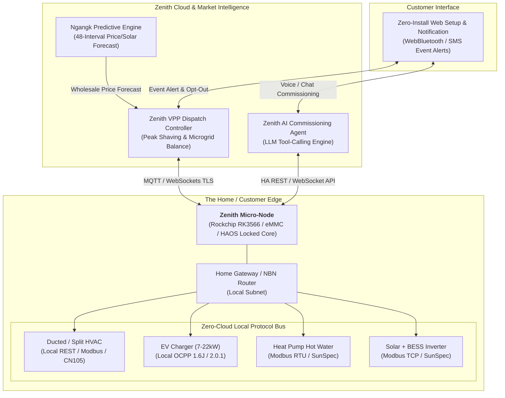
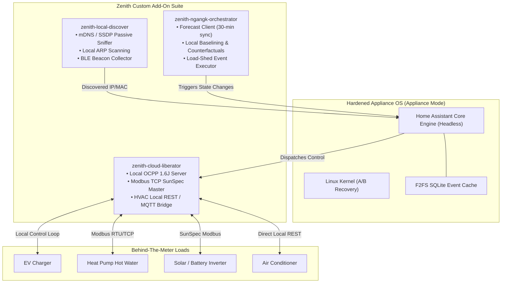
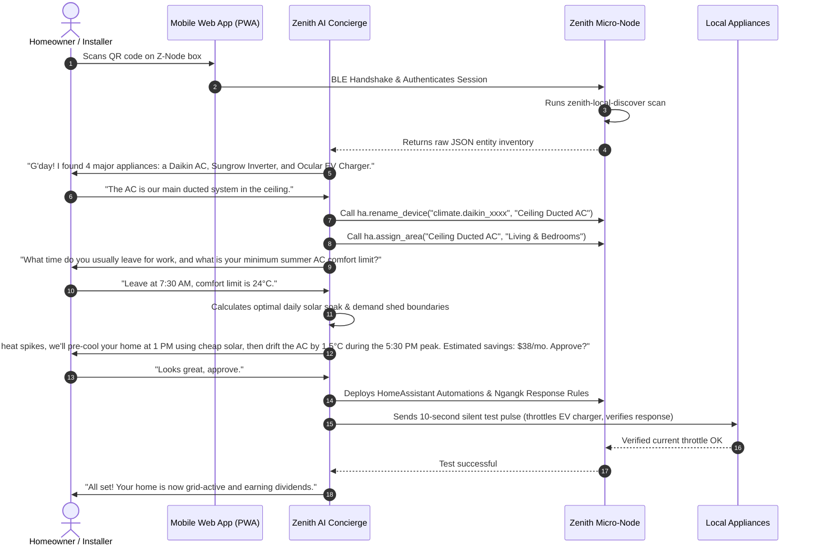
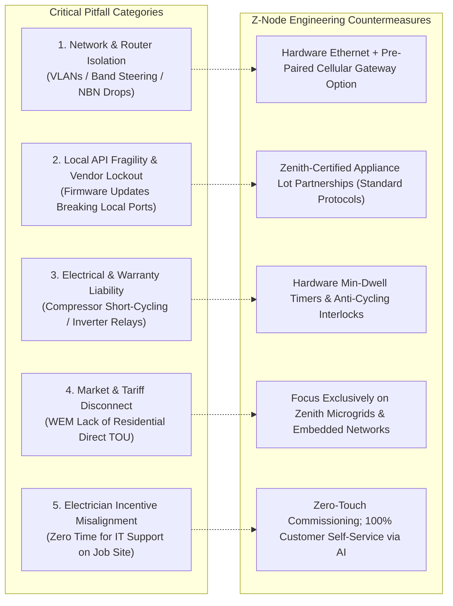
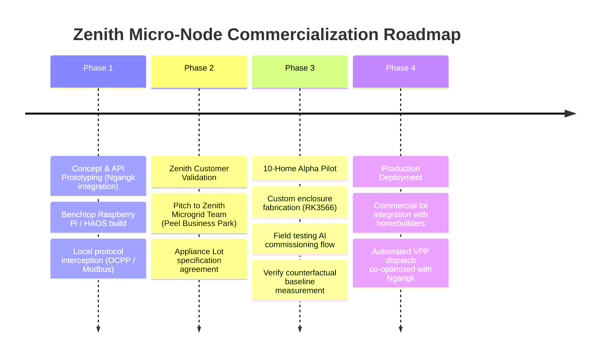

# Zenith Micro-Node & Zero-Friction BTM Load Orchestration
## System Architecture, Cloud-Liberation Layer & Autonomous Commissioning Engine

**Target Customer:** Zenith Energy (Grid-Connected Microgrids, Industrial Precincts & Embedded Residential Networks)  
**Project Code:** `Zenith Micro-Node` (`Z-Node`)  
**Context:** Western Australian Energy Market (WEM / SWIS) & Isolated Microgrids  
**Integration:** Ngangk WEM Predictive Energy Engine (`https://ngangk.deeben.workers.dev`)  

---

## 1. Executive Summary & The "Thorny Problem"

Behind-The-Meter (BTM) demand flexibility is widely heralded as the missing pillar of grid decarbonization. When wholesale prices spike or microgrid thermal peakers threaten to fire, residential loads (ducted HVAC, heat pump hot water, EV chargers, home BESS) can collectively shed megawatts within seconds—saving thousands of dollars and stabilizing network frequency.

However, the real-world rollout of BTM load control consistently stalls on three fatal friction points:
1. **The IT/OT Competency Chasm:** Electrical contractors installing heat pumps and EV chargers are licensed tradespeople, not network engineers. They cannot troubleshoot mDNS packet reflection, Wi-Fi 2.4 GHz band-steering, or static IP bindings.
2. **Platform Fragility & Cloud Hostility:** Existing consumer smart home platforms (Home Assistant, Tuya, SmartThings) require frequent maintenance, break upon vendor cloud API changes, and rely on SD cards that corrupt during power trips.
3. **Misaligned Market Incentives:** In the Western Australian SWIS, standard Synergy residential tariffs (A1 / DEBS) offer no real-time wholesale price exposure to homeowners. 

### The Solution: The Zenith Micro-Node (`Z-Node`)
A factory-sealed, ultra-low-maintenance appliance running a hardened, headless Home Assistant core. It plugs directly into the home router via Ethernet alongside the NBN box, discovers local smart appliances without cloud vendor tethers, and pairs with a cloud-hosted **Zenith AI Commissioning Agent**. 

Because **Zenith Energy** operates embedded microgrids (such as Peel Business Park and regional community networks) where Zenith acts as both retailer and generation/network operator, Zenith has direct financial exposure to peak generator fuel costs ($300–$650/MWh diesel peakers). Zenith can package pre-qualified smart appliances into residential land/home packages and pay homeowners a direct cash dividend per load-shed event.



---

## 2. Hardware Architecture (Home Assistant Compatible Appliance)

To eliminate the 90% warranty-return rate associated with DIY smart hubs, the hardware specification adheres to industrial appliance standards: zero moving parts, non-corruptible solid-state storage, and isolated hardware watchdogs.

### 2.1 Hardware Specification Comparison

| Component | DIY / Hobbyist Spec (Failure-Prone) | **Zenith Micro-Node Production Spec** | Rationale for Production Choice |
| :--- | :--- | :--- | :--- |
| **Processor** | Raspberry Pi Zero 2W (BCM2837) | **Rockchip RK3566 Quad-Core Cortex-A55 @ 1.8GHz** | Identical architecture to Home Assistant Green; native NPU for local voice/anomaly detection; superior I/O throughput. |
| **Storage** | MicroSD Card (Class 10) | **32GB eMMC 5.1 Flash (Soldered onboard)** | MicroSD cards suffer flash controller burnout under Home Assistant SQLite write loads. eMMC provides 10x write endurance and power-cut resilience. |
| **Memory** | 512MB / 1GB LPDDR2 | **2GB / 4GB LPDDR4** | Sufficient headroom to run SQLite/PostgreSQL telemetry caches and local protocol bridges simultaneously. |
| **Network Interface**| 2.4GHz Wi-Fi only | **10/100/1000M RJ45 Gigabit Ethernet** with optional IEEE 802.3af PoE | Ethernet directly next to NBN NTD avoids Wi-Fi mesh interference, credential changes, and RF attenuation in metal switchboards. |
| **Wireless Transceiver**| None / External USB Dongle | **Onboard Silicon Labs EFR32MG21 (Zigbee 3.0 & Matter-over-Thread)** | Allows zero-latency local control of sub-metering smart plugs and wireless room temperature probes without vendor hubs. |
| **Power Input** | USB-Micro 5V 1A | **5V Type-C or 12V–24V DC DIN Terminal** | Can be powered by standard NBN wall-pack or clipped directly into a switchboard DIN rail next to breaker panels. |
| **Enclosure** | 3D Printed Plastic | **UL94-V0 Flame-Retardant DIN Mount / Wall Caddy** | Electrician-compliant for installation inside customer garage enclosures or structured cabling cabinets. |
| **Watchdog Timer** | Software cron | **Hardware Watchdog IC (Texas Instruments TPS3823)** | Hard power-cycles the SoC if the Linux kernel or Home Assistant daemon hangs for >60 seconds. |

### 2.2 Boot & Partition Layout (Fail-Safe Appliance Mode)
The device runs a custom build of **Home Assistant OS (HAOS)** configured with an A/B dual-root partition scheme:
* **Partition A (Active Root - SquashFS / Read-Only):** Ensures the operating system cannot be corrupted by abrupt power outages during grid switching.
* **Partition B (Inactive Root - Over-the-Air Update Target):** Updates are written in background and verified via SHA256 before bootloader toggles the boot flag.
* **Partition Data (F2FS / Flash-Friendly File System):** Houses the local SQLite recorder, encryption keys, and Zenith appliance profiles.

---

## 3. Software Architecture (HA-Compatible Plugins & Local Liberation Layer)

The software philosophy is **"Radical Cloud Liberation"**: stripping the appliance of its dependence on third-party cloud servers (Daikin Cloud, Tesla Fleet API, Tuya Cloud, iStore servers) which introduce latency, breaking changes, and recurring subscription fees.



### 3.1 Plugin 1: `zenith-local-discover` (Zero-Config Sniffer)
Electricians will not log into routers to reserve IP addresses. The discovery daemon listens promiscuously across local broadcast domains:
* **mDNS / Bonjour Service Scanning:** Captures `_http._tcp`, `_daikin._tcp`, `_airtouch._tcp`, `_shelly._tcp`, and `_esphomelib._tcp`.
* **SSDP / UPnP Discovery:** Scans for standard home energy gateways, smart TVs, and bridge hardware.
* **Passive ARP & OUI Vendor Fingerprinting:** Identifies connected hardware MAC address prefixes (e.g., `00:1C:2B` for Fronius, `48:3F:DA` for Sungrow, `B8:27:EB` for local controllers).
* **BLE Advertisement Sniffing:** Detects nearby smart water heaters, pool chlorinators, and battery telemetry beacons.

### 3.2 Plugin 2: `zenith-cloud-liberator` (Protocol Interception)
To liberate hardware from cloud-first vendors, the Micro-Node runs local protocol endpoints:
1. **OCPP Local Server (EV Chargers):** Standard chargers (Ocular, Schneider EVlink, Wallbox) are configured during installation to point to `ws://zenith-node.local:9000` instead of a commercial CPO (Charge Point Operator) cloud. This gives the Micro-Node 100% deterministic start/stop and pilot current throttling (6A to 32A in 1A increments) with zero latency.
2. **Modbus TCP / SunSpec Gateway (Inverters & Batteries):** Bypasses Sungrow iSolarCloud, Fronius Solar.web, or SolarEdge monitoring portals, polling real-time AC generation, DC bus voltages, and battery state-of-charge directly over port 502 every 2 seconds.
3. **Local Climate Interceptor (HVAC):** Utilizes direct local REST bindings (e.g., AirTouch 4/5 local API on port 9005, Daikin local `/aircon/get_control_info`, or ESPHome-based CN105 HVAC connectors) to bypass cloud-side rate limiting.

### 3.3 Plugin 3: `zenith-ngangk-orchestrator` (Predictive Dispatch & Counterfactual Engine)
This plugin ties the local Home Assistant instance directly to the **Ngangk Predictive Energy Engine**:
* **Forecast Ingestion:** Every 30 minutes, pulls the SWIS wholesale price trajectory, solar irradiance curve, and peak demand alert flags via `GET /api/ngangk/forecast?horizon=24`.
* **Baseline Calculation:** Samples active household power (kW) every 10 seconds. Calculates a running 10-day rolling baseline for each controllable asset to determine the *counterfactual* (the energy the home would have consumed during an event).
* **Event Dispatch:** Executes shedding directives triggered by the Zenith VPP over an authenticated TLS WebSocket connection.

---

## 4. The Automagic AI Commissioning Agent

The most vulnerable step in home automation deployment is the initial handover. If a customer is confronted with a raw Home Assistant dashboard containing 120 unassigned entities like `sensor.shelly_em3_channel_1_power` and `climate.daikin_ap48201`, the system is abandoned.

The **Zenith Commissioning Concierge** is an AI agent built on a modern LLM tool-calling pattern, connected to the Micro-Node's Home Assistant WebSocket API via a secure relay.



### 4.1 Agent Tool Calling Schema (Exposed to AI Engine)
The agent interacts with the physical node strictly via validated tool functions:

```typescript
// Exposed to Zenith AI Agent Tool-Calling Runtime
interface ZenithAgentTools {
  // Discovery & Device Management
  getDiscoveredAppliances(): Promise<DiscoveredDevice[]>;
  mapDeviceToCategory(deviceId: string, category: 'hvac' | 'evse' | 'hpwh' | 'bess'): Promise<boolean>;
  assignDeviceMetadata(deviceId: string, friendlyName: string, room: string): Promise<boolean>;
  
  // Commissioning & Diagnostic Testing
  testApplianceControllability(deviceId: string, action: 'throttle_50_pct' | 'pause_5s' | 'bump_temp_1c'): Promise<DiagnosticResult>;
  
  // Strategy Generation & Rule Commitment
  generateHouseholdLoadContract(preferences: UserEnergyPreferences): Promise<LoadShedContract>;
  commitAutomationsToNode(contract: LoadShedContract): Promise<boolean>;
}
```

### 4.2 The Event Experience: Microgrid Load Shed in Action

When Ngangk predicts a supply shortfall or extreme wholesale price spike in the microgrid, the response sequence prioritizes **thermal pre-conditioning** and **zero-friction opt-out**:

```text
[16:45 AWST - SMS / Zenith App Push Alert]
--------------------------------------------------------------
⚡ ZENITH GRID EVENT NOTIFICATION ⚡
Microgrid Peak Window: 17:30 – 18:30 AWST (Today)

Zenith Incentive: $4.50 Direct Account Credit
Automatic Actions:
  • Ducted AC: Pre-cooling to 21°C now; relaxing to 24.5°C at 17:30
  • EV Charger: Pausing charging for 60 mins (Resumes at 18:30)
  • Heat Pump Water: Stored heat locked; compressor idle

You will release 3.2 kW of capacity to stabilize the precinct.
[TAP HERE TO OPT-OUT] (Takes 1 tap, no penalty)
--------------------------------------------------------------
```

If the customer opts out, the node immediately clears the dispatch state for that appliance and notifies the Zenith VPP aggregator to dispatch alternative grid-scale BESS reserves.

---

## 5. Potential Pitfalls & Contextual Analysis (WA / WEM / Microgrid Realities)

Deploying edge IoT hardware for grid-critical load control presents severe technical, electrical, and market failure modes. These must be addressed during the customer validation phase with Zenith.



### Pitfall 1: Local Network Topology & Router Hell
* **The Trap:** Australian homes are equipped with diverse ISP-supplied routers (Telstra Smart Modem Gen 3, Optus Ultra WiFi, Eero, Google Nest WiFi). Many enable strict **client isolation** (preventing local devices on Wi-Fi from communicating with an Ethernet-attached node), drop mDNS packets across 2.4 GHz and 5 GHz bands, or re-assign local DHCP IP leases on reboot.
* **Engineering Mitigation:** 
  1. The Z-Node uses Ethernet into the primary router LAN port, establishing raw L2 packet sniffing.
  2. For appliance communication, the node utilizes mDNS alongside host-level SSDP and passive ARP caching, mapping devices by static hardware MAC address rather than transient IP leases.
  3. For Zenith new-lot residential packages, Zenith can supply a pre-configured sub-router or specify a single supported home network bridge.

### Pitfall 2: Local API Hostility & Vendor Firmware Breakage
* **The Trap:** Manufacturers frequently issue automatic over-the-air firmware updates that deprecate local HTTP endpoints, enforce proprietary encryption, or lock users into cloud subscriptions (e.g., MyAir charging a monthly fee for remote control, Tesla shifting to signed cryptographic fleet endpoints).
* **Engineering Mitigation:** 
  * Zenith establishes an **"Approved Appliance Lot"** program. In Zenith-connected microgrids (e.g., eco-villages or industrial estates), Zenith supplies or certifies specific hardware models running open, non-deprecating industrial protocols:
    * **EVSE:** Standard OCPP 1.6J over local WebSockets (mandated by Australian EV charging guidelines).
    * **Heat Pumps & Inverters:** Modbus RTU / SunSpec over RS485 or TCP (industrial standard that cannot be removed by cloud updates).
    * **HVAC:** Systems with open serial/local interfaces (e.g., CoolAutomation, AirTouch 5 local API, or direct dry-contact demand response enabling DRED terminals).

### Pitfall 3: HVAC Short-Cycling & Manufacturer Warranty Invalidation
* **The Trap:** Aggressive grid-response algorithms that pulse air conditioning units or heat pumps off and on to chase 5-minute price spikes can cause compressor oil starvation, refrigerant slugging, or burn out internal contactors. If an air conditioner fails and the manufacturer logs show 30 start/stop cycles in a single afternoon, the $4,000 warranty claim is rejected, leaving Zenith liable.
* **Engineering Mitigation:** 
  * The Z-Node enforces **hard-coded safety guardrails** in the low-level Home Assistant state machine that cannot be overridden by cloud dispatch commands:
    * *Minimum Dwell Time:* Once an HVAC compressor is engaged or disengaged, it cannot change state for at least 15 minutes.
    * *Setpoint Offset Only:* The system never cuts raw mains power to the HVAC; it nudges the target temperature setpoint up or down by 1.5°C to 2.0°C, allowing the unit's onboard inverter logic to smoothly ramp down compressor frequency.
    * *Heat Pump Hot Water:* Control is exercised via thermal storage temperature targets (e.g., boosting to 65°C during solar hours, allowing normal coasting during peak hours), never dry-cycling the tank element.

### Pitfall 4: The WEM Tariff Architecture (Synergy Monopoly vs. Microgrid Economics)
* **The Trap:** In the general Western Australian SWIS, residential retail is restricted to state-owned retailer Synergy. Synergy offers flat tariffs (A1 at ~31c/kWh) or time-of-use (Midday Saver), but does *not* offer dynamic wholesale spot-price pass-through to residential households. If a homeowner saves $10 of wholesale energy during a price spike, Synergy pockets the $10, while the homeowner earns nothing.
* **Why Zenith Energy is the Critical Customer Beachhead:**
  * **Zenith Microgrids are Vertically Integrated:** In an embedded network, remote township, or industrial microgrid (like Peel Business Park), Zenith operates the generation (solar, wind, batteries, diesel/gas peakers) and acts as the network operator and retailer.
  * **Direct Fuel Avoidance:** When a Zenith microgrid hits peak load, every megawatt-hour shed saves Zenith direct diesel generation costs of **$300 to $650/MWh**.
  * **Shared Value Model:** Zenith can comfortably afford to pay the homeowner $4.00 for a 1-hour 3 kW load shed (costing Zenith $4.00, but saving Zenith $9.00 in fuel burn and engine wear). This makes the business model immediately viable without waiting for AEMO WEM market rule reforms.

### Pitfall 5: Electrician Labor Economics ("The 4:30 PM Friday Rule")
* **The Trap:** Residential electrical trades work on fixed-price contracts for appliance installs. If an electrician has to download an app, pair Wi-Fi, create an account, or troubleshoot why an appliance isn't responding, they will pack up and leave the smart features disconnected.
* **Engineering Mitigation:** 
  * The installation requires **zero electrical IT configuration**. The electrician's only instruction is: *"Mount the Z-Node, plug the supplied Ethernet cable into the NBN box, and plug in the power pack."*
  * All device discovery, network topology mapping, customer onboarding, room assignment, and functional verification is conducted **post-handover by the Zenith AI Concierge** directly with the homeowner on their smartphone.

---

## 6. Standalone Project Roadmap & Zenith Validation Strategy



### Next Steps for Customer Pitch to Zenith Energy:
1. **Interactive Demo Prototype:** Stand up a live benchtop unit containing the headless HAOS core, an OCPP simulated EV charger, and an inverter emulator, responding live to `https://ngangk.deeben.workers.dev/api/ngangk/forecast`.
2. **Economic Whitepaper Slide:** Show Zenith how a 200-home embedded microgrid equipped with Z-Nodes delivers a **600 kW / 1.2 MWh virtual battery** for an upfront capital outlay 80% lower than installing utility-scale containerized BESS.
3. **Draft Appliance Certification Standard:** Provide Zenith with the list of supported native-protocol hardware to include in their builder developer guidelines.
